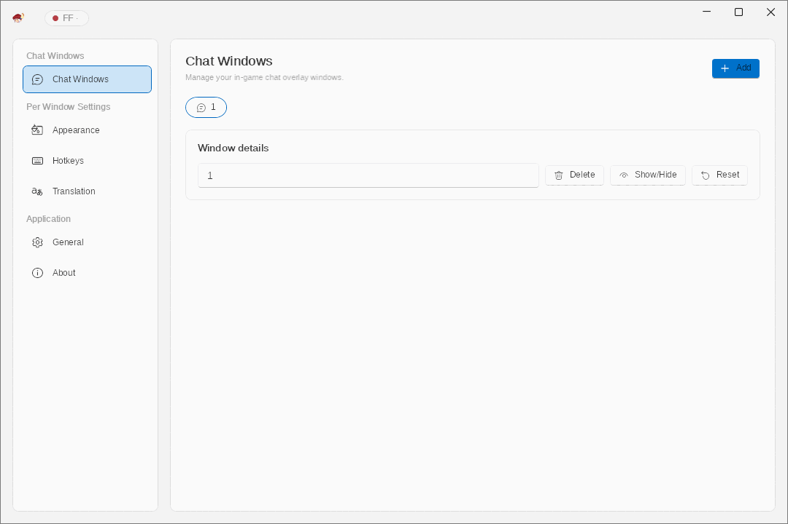
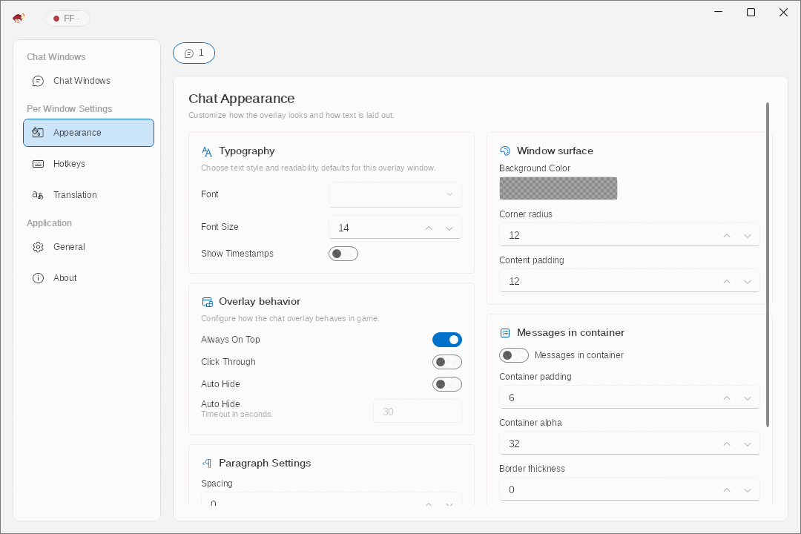
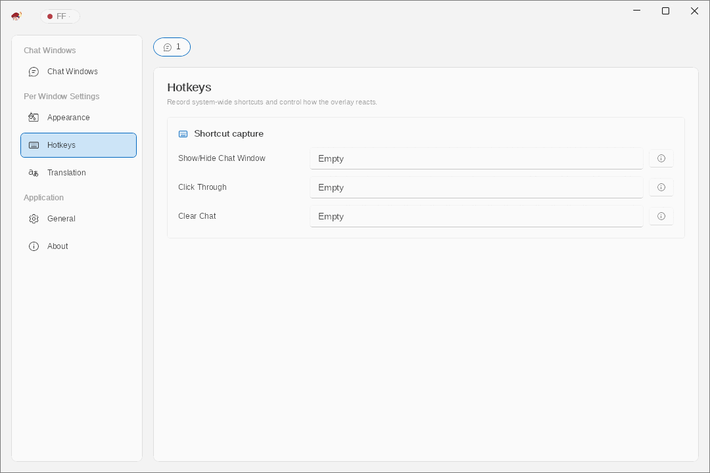
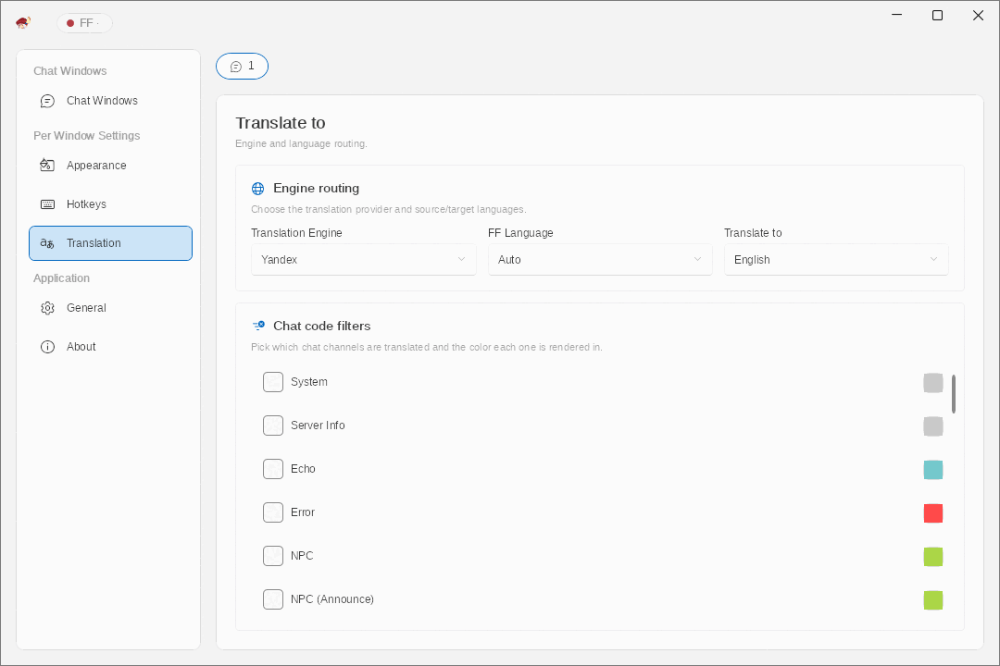
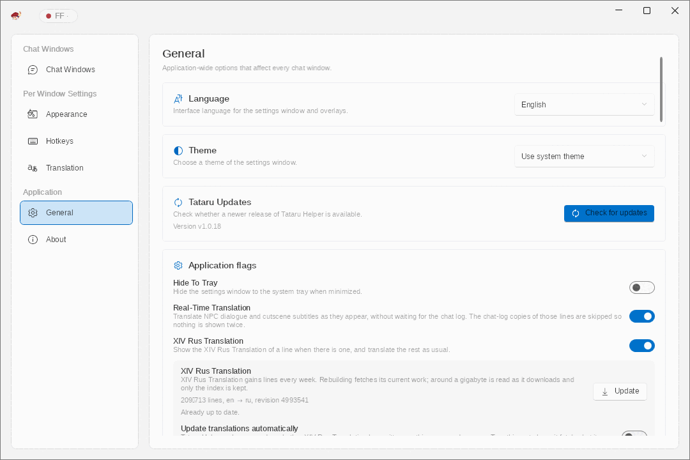
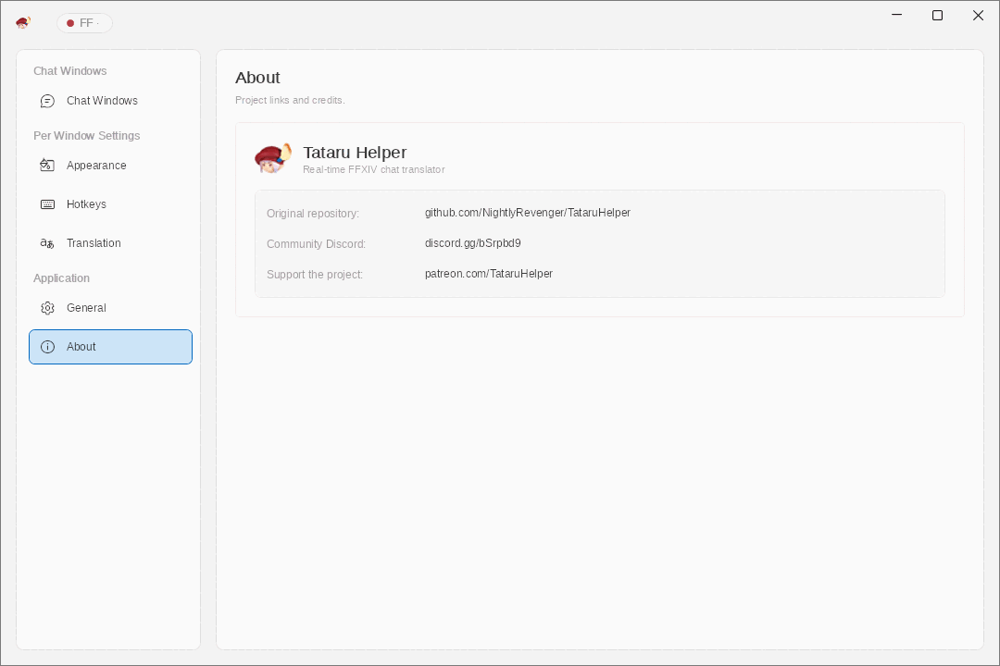

# Tataru Helper guide

[Русская версия](GuideRU.MD) · [README](../README.md) · [Linux](Linux.md) · [FAQ](https://github.com/NightlyRevenger/TataruHelper/wiki)

The settings window has six pages. The sidebar groups them: **Chat Windows**, the per-window pages (**Appearance**, **Hotkeys**, **Translation**) and the application-wide pages (**General**, **About**).

* [First start](#first-start)
* [Chat Windows](#chat-windows)
* [Appearance](#appearance)
* [Hotkeys](#hotkeys)
* [Translation](#translation)
* [General](#general)
* [About](#about)
* [When nothing is translated](#when-nothing-is-translated)

## First start

1. Start the game, then Tataru Helper.
2. Look at the **FF** status in the top-left corner of the settings window. *Process found* means the game is being read. *Couldn't find FFXIV process* means the game is not running, runs with DirectX 9, or Tataru Helper was started without administrator rights.
3. On [Translation](#translation) choose the engine, the game's language (**FF Language**, *Auto* works) and the language you want to read.
4. In the game's chat settings turn on the message types shown in the [README](../README.md#windows), then place the chat window where you like.

## Chat Windows

An overlay is a *chat window*. You can have several, each with its own engine, languages, look and hotkeys: for example one in Russian and one in English.

* **Add** creates another chat window. Its tab appears above the pages **Appearance**, **Hotkeys** and **Translation**; the settings of those pages belong to the selected tab.
* **Window name** is just a label for the tab.
* **Delete** removes the window.
* **Show/Hide** shows or hides the window, so you can see whether it sits where you want it.
* **Reset** puts the window back to its default position and size, for when you dragged it off the screen.

When *Click Through* is off, the right mouse button on a chat window opens a menu with the settings and Exit. Drag the window by its body and resize it by its edges.

## Appearance

The look of the selected chat window.

* **Typography:** font, font size, and whether each line shows a timestamp.
* **Overlay behavior:**
  * **Always On Top** keeps the window above the game. Leave it on.
  * **Click Through** lets mouse clicks pass through the window to the game. Use the [hotkey](#hotkeys) to switch it back, or the right-click menu will no longer open.
  * **Auto Hide** hides the window after the given number of seconds without new text.
* **Paragraph Settings:** **Spacing** adds spaces at the start of each line; **Line Break Height** adds distance between lines.
* **Window surface:** background color and transparency (RGB or HEX, with an alpha value), corner radius and padding.
* **Messages in container:** puts each message in its own rounded box, with its own padding, transparency and border. **Show only last message** keeps just the newest line on screen.

## Hotkeys

Three hotkeys for the selected chat window. Click a box and press the combination: Ctrl, Shift or Alt together with a key, or several modifiers at once. Each combination can be used only once.

* **Show/Hide Chat Window** hides the window when it is in the way and brings it back.
* **Click Through** turns click-through on and off.
* **Clear Chat** empties the window.

## Translation

* **Translation Engine:** which engine this chat window uses. Only the engines enabled on [General](#translators) are offered.
* **FF Language:** the language of the game's text. *Auto* detects it.
* **Translate to:** the language you read.
* **Chat code filters:** which chat channels are translated, one checkbox each, with the color the lines are drawn in. NPC dialogue and cutscene text are channels too, so keep them on.

Which engine to choose:

* **DeepL** is the most natural. It needs no key: a small relay program that ships with Tataru Helper starts and connects by itself, on Windows and through the Linux launcher. If it fails, translation continues on another enabled engine. **Advanced** under DeepL holds the address of a DeepLX server of your own and an optional **Connect browser** backup: once connected, the browser is tried after the relay and before other engines; keep its window open. It uses a separate profile, leaving your own browser data untouched.
* **Google Translate, Yandex, Bing, Papago** need no key either. If one refuses a request, another enabled engine takes over, and Bing waits for at least a minute before it is asked again.
* **Translate.com** and **ModernMT** are on by default as extra reserves; **Tencent TranSmart, Volcengine and Alibaba** can be turned on. Their dialogue translations were less accurate in a small test of ours. The results are in [the benchmark data](../reports/translator-candidates-2026-11-01.json).
* **With your own key:** DeepL API, Google Cloud, Azure Translator, Yandex Cloud, and the language models OpenAI, Claude, Gemini, DeepSeek, YandexGPT and OpenRouter. They are usually the most accurate and cost money by usage.
* **On your own machine:** Ollama and LM Studio run a model locally, with no key and no quota; LibreTranslate takes the address of a server.

## General

Options for the whole application. The page scrolls.

* **Language:** the interface language, 12 of them. **Theme:** light, dark or the system's.
* **Tataru Updates:** shows the version and checks for a newer one. Updates normally install themselves and restart the program.
* **Application flags:**
  * **Hide To Tray** hides the settings window to the system tray when minimized.
  * **Real-Time Translation** translates NPC dialogue and cutscene subtitles as they appear, without waiting for the chat log, and skips the chat-log copies so nothing shows twice.
  * **XIV Rus Translation** shows the hand-made Russian translation of a line when there is one and translates the rest with the engine. Appears when the game language and the reading language make it useful. **Update** downloads the current work of the translators, around a gigabyte of traffic and a small index on disk; **Update translations automatically** does it for you.
  * **Translate speaker names** and **Translate player nicknames** show names in the reading language. Turn the latter off to keep players' original spelling.
  * **Translate over the game's dialogue box** puts the translation in a copy of the game's own box, as well as in the chat window.
  * **Mark machine translation** puts a dot before lines an engine translated.
* **Reset** puts every setting back to what a fresh installation has. API keys and downloaded translations are kept.
* **Diagnostics:** **Collect diagnostics** writes a report of what Tataru Helper sees and packs it with the recent logs; send that archive along with a bug report.

### Translators

Further down are the engines, with a switch for each; a disabled engine disappears from the Translation page. **Free** ones need nothing. **With a key** ones have fields for the API key and where needed region, folder ID or model. **Local Models** take the address of Ollama, LM Studio or LibreTranslate. Keys are kept on your computer.

## About

Links to the repository, the community [Discord](https://discord.gg/bSrpbd9) and where to support the project.

## When nothing is translated

1. The **FF** status must say *Process found*. If not, start the game first, run Tataru Helper as administrator, and check that the game runs in DirectX 11.
2. The chat message types from the [README](../README.md#windows) must be on in the game.
3. On [Translation](#translation) the **FF Language** must match the game, and the channels must be ticked.
4. Try another engine. Free engines sometimes refuse requests for a while; the others are tried automatically.
5. The log is `Log.txt` in `%AppData%\TataruHelper` (on Linux, in the game's Wine prefix: [see here](Linux.md#when-something-goes-wrong)). **Collect diagnostics** on [General](#general) packs it for you.

If that does not help, ask in [Discord](https://discord.gg/bSrpbd9) or [open an issue](https://github.com/NightlyRevenger/TataruHelper/issues/new/choose) with the diagnostics archive.
