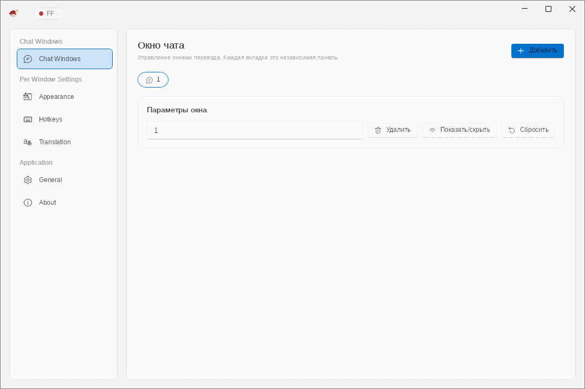
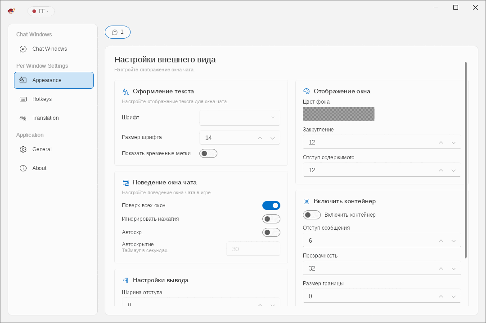
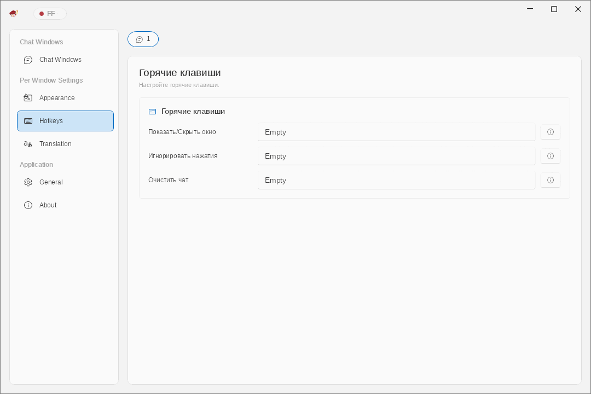
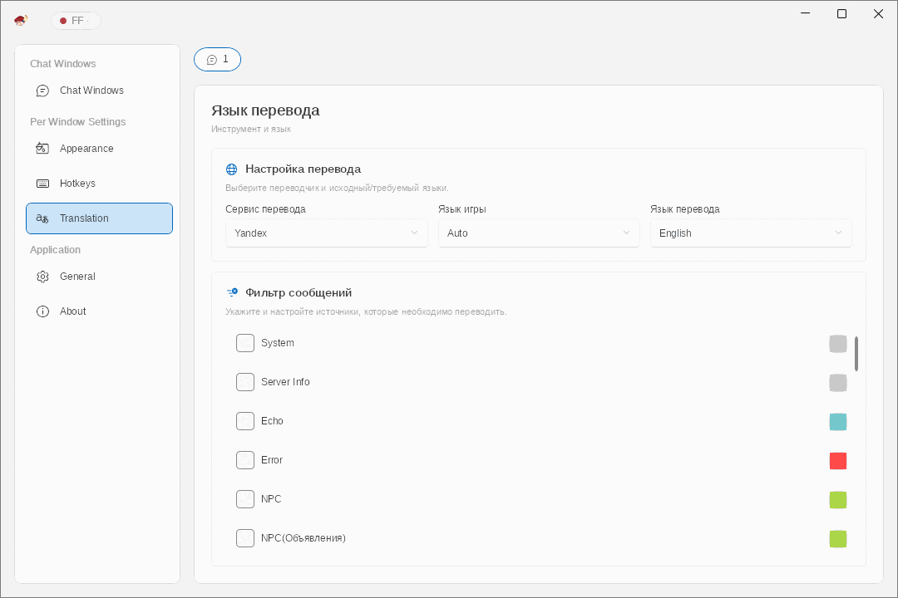
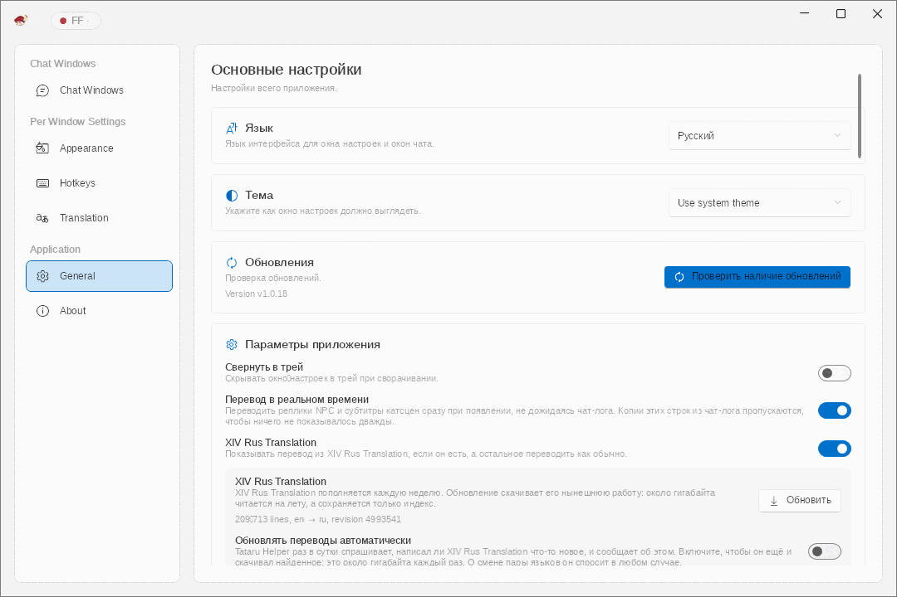
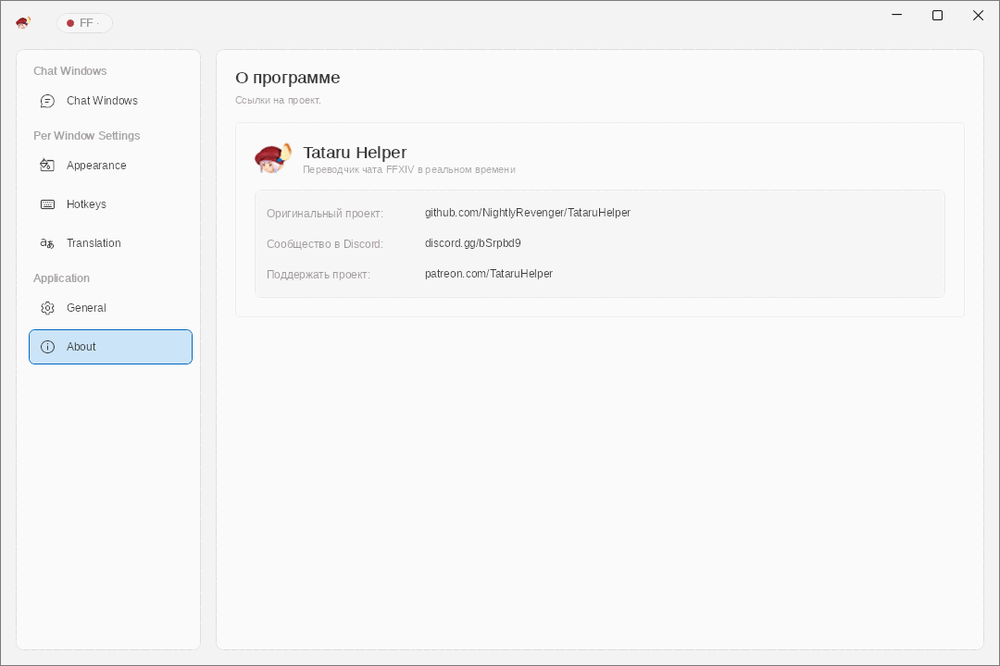

# Руководство по Tataru Helper

[English version](Guide.MD) · [README](README_ru_RU.md) · [Linux](LinuxRU.md) · [FAQ](https://github.com/NightlyRevenger/TataruHelper/wiki/Russian)

В окне настроек шесть страниц. В боковом меню они сгруппированы: **Chat Windows** («Окно чата»), страницы выбранного окна (**Appearance**, **Hotkeys**, **Translation**) и страницы всего приложения (**General**, **About**).

> Пункты бокового меню в приложении пока остаются на английском, а заголовки и подписи внутри страниц переведены. Так же и на скриншотах ниже; в тексте ниже страницы названы по-русски, с названием пункта меню в скобках.

* [Первый запуск](#первый-запуск)
* [Окна чата](#окна-чата)
* [Внешний вид](#внешний-вид-appearance)
* [Горячие клавиши](#горячие-клавиши-hotkeys)
* [Перевод](#перевод-translation)
* [Основные настройки](#основные-настройки-general)
* [О программе](#о-программе)
* [Если ничего не переводится](#если-ничего-не-переводится)

## Первый запуск

1. Запустите игру, затем Tataru Helper.
2. Посмотрите на статус **FF** в левом верхнем углу окна настроек. *Process found* — игра читается. *Couldn't find FFXIV process* — игра не запущена, идёт с DirectX 9 или Tataru Helper запущен без прав администратора.
3. На странице [Перевод](#перевод-translation) выберите сервис перевода, язык игры (**Язык игры**, подойдёт *Auto*) и язык, на котором хотите читать.
4. В настройках чата игры включите типы сообщений со снимка в [README](README_ru_RU.md), затем поставьте окно чата, где вам удобно.

## Окна чата

Каждая накладка — это *окно чата*. Их может быть несколько, у каждого свои сервис, языки, вид и горячие клавиши: например, одно на русском и одно на английском.

* **Добавить** создаёт ещё одно окно чата. Его вкладка появляется над страницами «Внешний вид», «Горячие клавиши» и «Перевод»: настройки этих страниц относятся к выбранной вкладке.
* **Название окна** — просто подпись вкладки.
* **Удалить** убирает окно.
* **Показать/скрыть** показывает или прячет окно, чтобы увидеть, где оно стоит.
* **Сбросить** возвращает окно на место и к исходному размеру, если вы утащили его за край экрана.

Когда **Игнорировать нажатия** выключено, правая кнопка мыши на окне чата открывает меню с настройками и выходом. Окно двигают за любое место и растягивают за края.

## Внешний вид (Appearance)

Как выглядит выбранное окно чата.

* **Оформление текста:** шрифт, размер шрифта и показ временных меток у каждой строки.
* **Поведение окна чата:**
  * **Поверх всех окон** держит окно поверх игры. Оставьте включённым.
  * **Игнорировать нажатия** пропускает щелчки мыши сквозь окно к игре. Вернуть назад можно [горячей клавишей](#горячие-клавиши-hotkeys): меню по правой кнопке в этом режиме не откроется.
  * **Автоскр.** прячет окно через заданное **Автоскрытие** число секунд без нового текста.
* **Настройки вывода:** **Ширина отступа** добавляет пробелы в начале каждой строки, **Межабзацный интервал** увеличивает расстояние между строками.
* **Отображение окна:** цвет и прозрачность фона (RGB или HEX и значение альфа), закругление углов и отступ содержимого.
* **Включить контейнер:** каждое сообщение в своей скруглённой рамке со своими отступом, прозрачностью и границей. **Показывать только последнее сообщение** оставляет на экране только самую свежую строку.

## Горячие клавиши (Hotkeys)

Три горячие клавиши выбранного окна чата. Нажмите на поле и введите сочетание: Ctrl, Shift или Alt вместе с клавишей, либо несколько модификаторов сразу. Одно сочетание нельзя назначить дважды.

* **Показать/Скрыть окно** прячет окно, когда оно мешает, и возвращает его.
* **Игнорировать нажатия** включает и выключает прохождение щелчков.
* **Очистить чат** очищает окно.

## Перевод (Translation)

* **Сервис перевода:** какой сервис использует это окно чата. Предлагаются только сервисы, включённые на странице [Основные настройки](#переводчики).
* **Язык игры:** язык текста в игре. *Auto* определяет его сам.
* **Язык перевода:** язык, на котором вы читаете.
* **Фильтр сообщений:** какие каналы чата переводить: по галочке на канал и цвет, которым рисуются строки. Диалоги NPC и тексты катсцен — тоже каналы, не выключайте их.

Какой сервис выбрать:

* **DeepL** переводит естественнее всех. Ключ не нужен: небольшая программа-реле из комплекта Tataru Helper запускается и подключается сама, на Windows и через лаунчер на Linux. Если она не сработала, перевод продолжит другой включённый сервис. В разделе **Advanced** у DeepL — адрес вашего сервера DeepLX и запасной вариант **Connect browser**: после подключения браузер пробуется после реле и перед остальными сервисами; окно браузера держите открытым. Он работает в отдельном профиле и не трогает данные вашего обычного браузера.
* **Google Translate, Yandex, Bing, Papago** тоже работают без ключа. Если сервис отказал, подхватывает другой включённый, а Bing не опрашивается минимум минуту.
* **Translate.com** и **ModernMT** включены по умолчанию как дополнительный запас; **Tencent TranSmart, Volcengine и Alibaba** можно включить. В нашей небольшой проверке их переводы диалогов были менее точными. Результаты — в [данных сравнения](../reports/translator-candidates-2026-11-01.json).
* **С вашим ключом (платные):** DeepL API, Google Cloud, Azure Translator, Yandex Cloud и языковые модели OpenAI, Claude, Gemini, DeepSeek, YandexGPT и OpenRouter. Обычно они точнее всех, но платные — по расходу.
* **На вашем компьютере:** Ollama и LM Studio запускают модель локально, без ключа и лимитов; LibreTranslate принимает адрес сервера.

## Основные настройки (General)

Настройки всего приложения. Страница прокручивается.

* **Язык:** язык интерфейса, их 12. **Тема:** светлая, тёмная или как в системе.
* **Обновления:** версия и проверка новой. Обычно обновления ставятся сами, и программа перезапускается.
* **Параметры приложения:**
  * **Свернуть в трей** прячет окно настроек в трей при сворачивании.
  * **Перевод в реальном времени** переводит реплики NPC и субтитры катсцен сразу, не дожидаясь чата, а их копии из лога чата пропускает, чтобы ничего не показывалось дважды.
  * **XIV Rus Translation** показывает ручной русский перевод строки, если он есть, а остальное переводит сервисом. Блок с индексом появляется, когда язык игры и язык чтения это оправдывают. **Обновить** скачивает свежую работу переводчиков: около гигабайта трафика и небольшой индекс на диске; **Обновлять переводы автоматически** делает это сам.
  * **Переводить имена говорящих** и переключатель имён игроков показывают имена на языке чтения. Имена игроков выключите, чтобы оставить оригинальное написание ников.
  * Переключатель перевода поверх диалогового окна игры кладёт перевод в копию родного окна диалога, в дополнение к окну чата.
  * **Отмечать машинный перевод** ставит точку перед строками, переведёнными сервисом.
* **Сбросить настройки** возвращает все настройки к состоянию свежей установки. Ключи API и скачанные переводы сохраняются.
* **Диагностика:** **Собрать диагностику** собирает отчёт о том, что видит Tataru Helper, и упаковывает его с последними журналами. Приложите этот архив к сообщению об ошибке.

### Переводчики

Ниже — сами сервисы, у каждого переключатель; выключенный пропадает со страницы «Перевод». **Бесплатным** ничего не нужно. У **платных** есть поля для ключа API и, где требуется, региона, ID каталога или модели. Локальные модели принимают адрес Ollama, LM Studio или LibreTranslate. Ключи хранятся на вашем компьютере.

## О программе

Ссылки на репозиторий, сообщество в [Discord](https://discord.gg/bSrpbd9) и способ поддержать проект.

## Если ничего не переводится

1. Статус **FF** должен показывать *Process found*. Если нет — сначала запустите игру, запустите Tataru Helper от имени администратора и проверьте, что игра работает на DirectX 11.
2. В игре должны быть включены типы сообщений чата со снимка в [README](README_ru_RU.md).
3. На странице [Перевод](#перевод-translation) **Язык игры** должен совпадать с игрой, а нужные каналы — быть отмечены.
4. Попробуйте другой сервис. Бесплатные иногда отказывают на время; остальные пробуются автоматически.
5. Журнал — файл `Log.txt` в `%AppData%\TataruHelper` (на Linux — в префиксе Wine игры: [см. здесь](LinuxRU.md)). Кнопка **Собрать диагностику** на странице [Основные настройки](#основные-настройки-general) упакует его за вас.

Если не помогло, спросите в [Discord](https://discord.gg/bSrpbd9) или [создайте issue](https://github.com/NightlyRevenger/TataruHelper/issues/new/choose), приложив архив диагностики.
