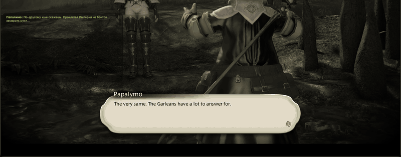

<p align="center">
  
</p>

<h1 align="center">Tataru Helper</h1>

<p align="center">파이널 판타지 14 실시간 번역 오버레이: 스토리, 컷신, 퀘스트, NPC 대사, 채팅.</p>
<p align="center">[xDarkOne](https://github.com/xDarkOne)가 관리합니다. 원작자는 [NightlyRevenger](https://github.com/NightlyRevenger)입니다.</p>

<p align="center">
  <a href="https://github.com/NightlyRevenger/TataruHelper/actions/workflows/build.yml"></a>
  <a href="https://github.com/NightlyRevenger/TataruHelper/releases/latest"></a>
  
  
  <a href="../LICENSE"></a>
  <a href="https://github.com/NightlyRevenger/TataruHelper/releases"></a>
  <a href="https://crowdin.com/project/tataru-helper"></a>
  <a href="https://discord.gg/bSrpbd9"></a>
</p>

<p align="center"><strong><a href="https://github.com/NightlyRevenger/TataruHelper/releases/latest/download/Setup.exe">Setup.exe 다운로드</a></strong> · <a href="Guide.MD">가이드(영어)</a> · <a href="Linux.md">Linux</a> · <a href="https://github.com/NightlyRevenger/TataruHelper/wiki">FAQ</a> · <a href="https://discord.gg/bSrpbd9">Discord</a></p>

<p align="center"><strong>언어:</strong> <a href="../README.md">EN</a> | <a href="README_ru_RU.md">RU</a> | <a href="README_ko_KR.md">KO</a> | <a href="README_es_ES.md">ES</a> | <a href="README_ca_ES.md">CA</a> | <a href="README_pl_PL.md">PL</a> | <a href="README_pt_BR.md">PT-BR</a> | <a href="README_uk_UA.md">UK</a> | <a href="README_zh_ZH.md">ZH</a> | <a href="README_ja_JP.md">JA</a></p>

<p align="center">
  
</p>

## 기능

- 게임 속 텍스트가 나타나는 대로 번역합니다: 메인 스토리, 컷신 자막, 퀘스트, NPC 대사, 채팅.
- 게임에서 직접 텍스트를 읽으므로 복사하고 붙여넣을 필요가 없습니다.
- 무료 엔진을 포함한 다양한 번역 엔진을 지원하며, 한 엔진이 실패하면 자동으로 다른 엔진으로 넘어갑니다. [번역 엔진](#번역-엔진)을 참고하세요.
- 엔진, 언어, 글꼴, 색상, 단축키를 각각 따로 지정할 수 있는 여러 개의 독립된 채팅 창.
- 번역할 채팅 채널과 채널별 색상을 선택할 수 있습니다.
- 수동 번역 [XIV Rus Translation](https://github.com/xivrus/xiv_ru_weblate)이(가) 있으면 기계 번역 대신 그것을 보여 줍니다.
- 오버레이는 클릭 통과, 항상 위, 자동 숨김을 지원하며 단축키로 제어할 수 있습니다.
- 12개 언어 인터페이스. 업데이트는 자동으로 설치됩니다.

## 요구 사항

- DirectX 11(64비트 클라이언트)로 실행되는 파이널 판타지 14.
- **64비트 Windows 10 또는 11.** 시작할 때 관리자 권한을 요청합니다. 프로그램이 게임 메모리에서 텍스트를 읽기 때문입니다. .NET을 따로 설치할 필요는 없으며 릴리스에 포함되어 있습니다.
- **또는 Linux**에서 Wine으로 실행한 게임. [Linux에서 TataruHelper 사용하기](Linux.md)를 참고하세요. 지원은 실험적입니다(영어 문서).

## 설치

### Windows

1. [latest release](https://github.com/NightlyRevenger/TataruHelper/releases/latest)에서 [`Setup.exe`](https://github.com/NightlyRevenger/TataruHelper/releases/latest/download/Setup.exe)을 내려받습니다.
2. 실행합니다. SmartScreen이 나타나면 **추가 정보**를 누른 다음 **실행**을 선택하세요.
3. 게임을 먼저 켜고, 시작 메뉴나 바탕화면 바로 가기에서 Tataru Helper를 실행합니다(`Setup.exe`를 다시 실행하지 마세요). 업데이트는 자동으로 설치됩니다.
4. 설정에서 게임 언어와 읽을 언어를 고르고, 오버레이를 원하는 위치에 놓습니다.
5. 게임의 채팅 설정에서 아래 그림의 메시지 유형을 켭니다(아무 탭에서나 가능):


모든 릴리스에는 휴대용 빌드 `Portable.zip`도 첨부됩니다.

### Linux

```sh
curl -LO https://raw.githubusercontent.com/NightlyRevenger/TataruHelper/master/scripts/linux/tataru-linux.sh
chmod +x tataru-linux.sh
./tataru-linux.sh install
```

스크립트가 게임이 실행 중인 Wine을 찾아 그 옆에서 Tataru Helper를 시작합니다. 자세한 내용, 동작하는 것과 아직 안 되는 것, 문제 해결은 [Documents/Linux.md](Linux.md)(영어)에 있습니다.

## 번역 엔진

| 종류 | 엔진 |
| --- | --- |
| 무료, 키·계정 불필요 | DeepL(포함된 로컬 릴레이 사용), Google Translate, Yandex, Bing, Translate.com, ModernMT, Papago. Tencent TranSmart, Volcengine, Alibaba도 켤 수 있음 |
| 본인의 키 사용 | DeepL API, Google Cloud, Azure Translator, Yandex Cloud, OpenAI, Claude, Gemini, DeepSeek, YandexGPT, OpenRouter |
| 내 컴퓨터 또는 서버 | Ollama, LM Studio, LibreTranslate |

엔진이 요청을 거부하면 다음으로 켜 둔 엔진이 이어받습니다. 엔진별 설정 방법은 [가이드](Guide.MD#translation)(영어)를 참고하세요.

## 문서

- [가이드](Guide.MD)([러시아어](GuideRU.MD)): 모든 설정 페이지 설명(영어).
- [Linux에서 TataruHelper 사용하기](Linux.md)([러시아어](LinuxRU.md)), 영어.
- [FAQ](https://github.com/NightlyRevenger/TataruHelper/wiki) 및 문제 해결, 여러 언어로 제공.
- [게임 읽기](ReadingTheGame.md): 게임에서 대사를 읽어 오는 방법. 이 부분을 수정하려는 사람을 위한 문서(영어).
- 동영상: [YouTube 시연](https://youtu.be/7HiQXzmkQuw).




## 기여하기

- 질문과 아이디어: [Discord](https://discord.gg/bSrpbd9) 또는 [issues](https://github.com/NightlyRevenger/TataruHelper/issues/new/choose).
- 코드: pull request를 환영합니다. 먼저 [CONTRIBUTING.md](../CONTRIBUTING.md)(영어)를 읽어 주세요.
- 인터페이스 번역: [Crowdin](https://crowdin.com/project/tataru-helper).
- 보안 문제: [SECURITY.md](../SECURITY.md).

## 감사의 말

Tataru Helper를 가능하게 한 모든 기여자와 프로젝트에 감사드립니다.

- [TataruHelper (NightlyRevenger)](https://github.com/NightlyRevenger/TataruHelper): 원본. 이 프로젝트는 그 포크입니다
- [TataruHelper (progneo)](https://github.com/progneo/TataruHelper): 이 프로젝트가 이어받은 포크
- [Sharlayan](https://github.com/FFXIVAPP/sharlayan): 게임 메모리에서 텍스트를 읽음
- [XIV Rus Translation](https://github.com/xivrus/xiv_ru_weblate): 수동 러시아어 번역
- [WPF Toolkit](https://github.com/xceedsoftware/wpftoolkit)
- [NHotKey.Wpf](https://github.com/thomaslevesque/NHotkey)
- [NotifyIcon WPF](https://bitbucket.org/hardcodet/notifyicon-wpf/)
- [Velopack](https://github.com/velopack/velopack): 설치 프로그램 및 업데이터
- [Tataru Art (Nezusagi)](https://www.deviantart.com/nezusagi)

### 같은 일을 다른 방식으로

[Dalamud](https://github.com/goatcorp/Dalamud)를 사용한다면 [Echoglossian](https://github.com/lokinmodar/Echoglossian)도 알아 둘 만합니다. 옆의 오버레이가 아니라 게임 안에서 대사를 번역하는 플러그인입니다.

## 라이선스

[MIT](../LICENSE)
