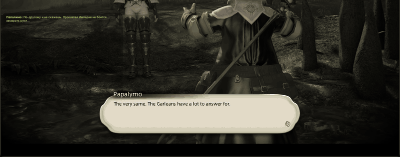

<p align="center">
  
</p>

<h1 align="center">Tataru Helper</h1>

<p align="center">Перевод Final Fantasy XIV в реальном времени поверх игры: сюжет, катсцены, квесты, реплики NPC и чат.</p>
<p align="center">Развивает <a href="https://github.com/xDarkOne">xDarkOne</a>. Автор оригинала — <a href="https://github.com/NightlyRevenger">NightlyRevenger</a>.</p>

<p align="center">
  <a href="https://github.com/NightlyRevenger/TataruHelper/actions/workflows/build.yml"></a>
  <a href="https://github.com/NightlyRevenger/TataruHelper/releases/latest"></a>
  
  
  <a href="../LICENSE"></a>
  <a href="https://github.com/NightlyRevenger/TataruHelper/releases"></a>
  <a href="https://crowdin.com/project/tataru-helper"></a>
  <a href="https://discord.gg/bSrpbd9"></a>
</p>

<p align="center"><strong><a href="https://github.com/NightlyRevenger/TataruHelper/releases/latest/download/Setup.exe">Скачать Setup.exe</a></strong> · <a href="GuideRU.MD">Руководство</a> · <a href="LinuxRU.md">Linux</a> · <a href="https://github.com/NightlyRevenger/TataruHelper/wiki/Russian">FAQ</a> · <a href="https://discord.gg/bSrpbd9">Discord</a></p>

<p align="center"><strong>Языки:</strong> <a href="../README.md">EN</a> | <a href="README_ru_RU.md">RU</a> | <a href="README_ko_KR.md">KO</a> | <a href="README_es_ES.md">ES</a> | <a href="README_ca_ES.md">CA</a> | <a href="README_pl_PL.md">PL</a> | <a href="README_pt_BR.md">PT-BR</a> | <a href="README_uk_UA.md">UK</a> | <a href="README_zh_ZH.md">ZH</a> | <a href="README_ja_JP.md">JA</a></p>

<p align="center">
  
</p>

## Возможности

- Переводит текст игры по мере появления: основной сюжет, субтитры катсцен, квесты, реплики NPC и чат.
- Читает текст из самой игры — копировать и вставлять ничего не нужно.
- Много сервисов перевода, в том числе бесплатных; если один отказал, подхватывает другой. См. [Сервисы перевода](#сервисы-перевода).
- Несколько независимых окон чата, у каждого свои сервис, языки, шрифты, цвета и горячие клавиши.
- Можно выбрать, какие каналы чата переводить, и цвет каждого.
- Показывает ручной [XIV Rus Translation](https://github.com/xivrus/xiv_ru_weblate) вместо машинного там, где он есть.
- Окно можно сделать «прозрачным для щелчков», держать поверх игры, автоматически скрывать и управлять им горячими клавишами.
- Интерфейс на 12 языках. Обновления ставятся сами.

## Требования

- Final Fantasy XIV с DirectX 11 (64-разрядный клиент).
- **Windows 10 или 11, 64-разрядная.** При запуске запрашиваются права администратора: программа читает текст игры из её памяти. Ставить .NET не нужно — он идёт в комплекте.
- **Или Linux**, где игра запущена под Wine. См. [TataruHelper на Linux](LinuxRU.md); поддержка экспериментальная.

## Установка

### Windows

1. Скачайте [`Setup.exe`](https://github.com/NightlyRevenger/TataruHelper/releases/latest/download/Setup.exe) из [последнего релиза](https://github.com/NightlyRevenger/TataruHelper/releases/latest).
2. Запустите его. Если появится SmartScreen, нажмите **Подробнее**, затем **Выполнить в любом случае**.
3. Запустите игру, затем Tataru Helper из меню «Пуск» или ярлыком на рабочем столе (не `Setup.exe` повторно). Обновления ставятся сами.
4. В настройках выберите язык игры и язык, на котором хотите читать, и поставьте окно, где вам удобно.
5. В настройках чата игры включите типы сообщений со снимка ниже, на любой вкладке:


К каждому релизу приложена переносимая сборка `Portable.zip`.

### Linux

```sh
curl -LO https://raw.githubusercontent.com/NightlyRevenger/TataruHelper/master/scripts/linux/tataru-linux.sh
chmod +x tataru-linux.sh
./tataru-linux.sh install
```

Скрипт находит Wine, на котором запущена игра, и запускает Tataru Helper рядом. Подробности, что работает и что пока нет, а также решение проблем — в [Documents/LinuxRU.md](LinuxRU.md).

## Сервисы перевода

| Вид | Сервисы |
| --- | --- |
| Бесплатные, без ключа и аккаунта | DeepL (через входящее в комплект локальное реле), Google Translate, Yandex, Bing, Translate.com, ModernMT, Papago; можно включить Tencent TranSmart, Volcengine и Alibaba |
| С вашим ключом | DeepL API, Google Cloud, Azure Translator, Yandex Cloud, OpenAI, Claude, Gemini, DeepSeek, YandexGPT, OpenRouter |
| На вашем компьютере или сервере | Ollama, LM Studio, LibreTranslate |

Если сервис отказал, подхватывает следующий включённый. Как настроить каждый — в [руководстве](GuideRU.MD#перевод-translation).

## Документация

- [Руководство](GuideRU.MD) ([in English](Guide.MD)): все страницы настроек.
- [TataruHelper на Linux](LinuxRU.md) ([in English](Linux.md)).
- [FAQ и решение проблем](https://github.com/NightlyRevenger/TataruHelper/wiki/Russian) на нескольких языках.
- [Как читается игра](ReadingTheGame.md): как реплики достаются из игры — для тех, кто меняет эту часть (на английском).
- Видео: [демонстрация на YouTube](https://youtu.be/7HiQXzmkQuw).




## Участие

- Вопросы и идеи: [Discord](https://discord.gg/bSrpbd9) или [issues](https://github.com/NightlyRevenger/TataruHelper/issues/new/choose).
- Код: pull request'ы приветствуются; сначала прочитайте [CONTRIBUTING.md](../CONTRIBUTING.md) (на английском).
- Перевод интерфейса: [Crowdin](https://crowdin.com/project/tataru-helper).
- Проблемы безопасности: [SECURITY.md](../SECURITY.md).

## Благодарности

Спасибо всем участникам и проектам, благодаря которым появился Tataru Helper:

- [TataruHelper от NightlyRevenger](https://github.com/NightlyRevenger/TataruHelper): оригинал, от которого этот проект ответвился
- [TataruHelper от progneo](https://github.com/progneo/TataruHelper): форк, который этот проект продолжает
- [Sharlayan](https://github.com/FFXIVAPP/sharlayan): чтение текста игры из памяти
- [XIV Rus Translation](https://github.com/xivrus/xiv_ru_weblate): ручной перевод на русский
- [WPF Toolkit](https://github.com/xceedsoftware/wpftoolkit)
- [NHotKey.Wpf](https://github.com/thomaslevesque/NHotkey)
- [NotifyIcon WPF](https://bitbucket.org/hardcodet/notifyicon-wpf/)
- [Velopack](https://github.com/velopack/velopack): установщик и обновления
- [Рисунок Тару от Nezusagi](https://www.deviantart.com/nezusagi)

### То же самое по-другому

Если вы играете с [Dalamud](https://github.com/goatcorp/Dalamud), обратите внимание на
[Echoglossian](https://github.com/lokinmodar/Echoglossian): плагин, который переводит диалоги
внутри самой игры, а не в окне рядом.

## Лицензия

[MIT](../LICENSE)
