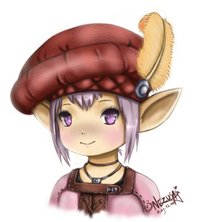
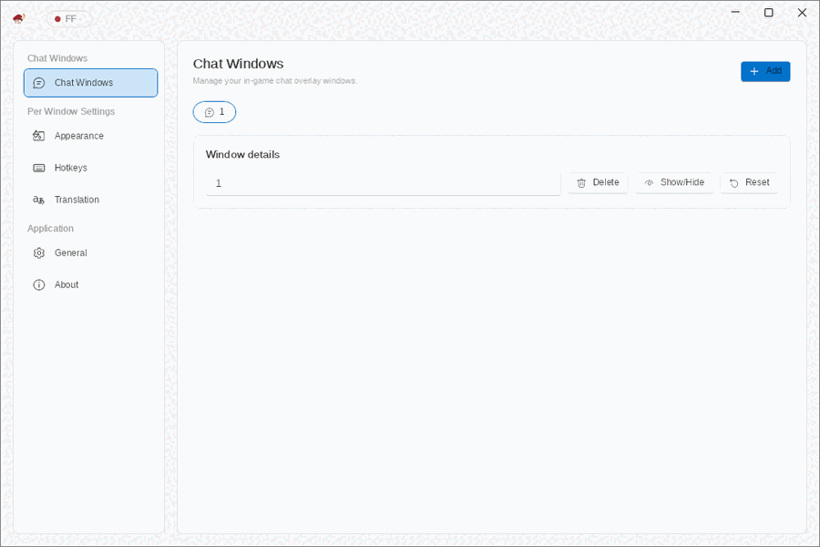
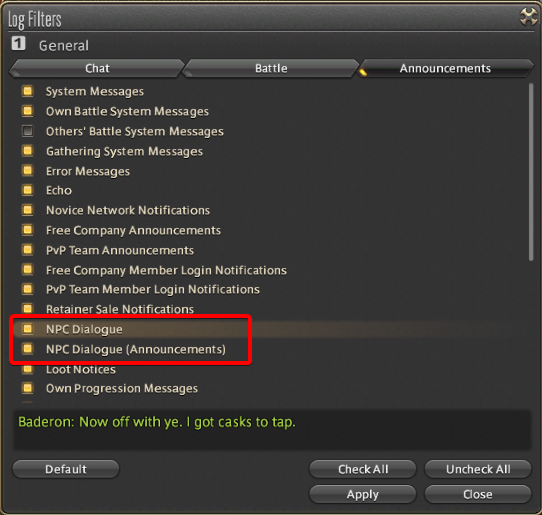
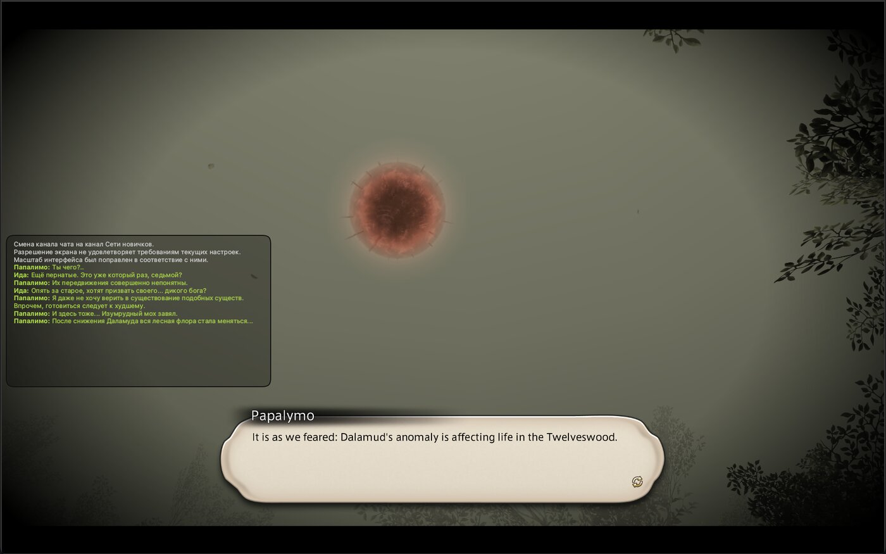

<p align="center">
  
</p>

<h1 align="center">Tataru Helper</h1>

<p align="center">Накладка для перекладу Final Fantasy XIV у реальному часі: сюжет, відеосцени, завдання, репліки NPC і чат.</p>
<p align="center">Розвиває [xDarkOne](https://github.com/xDarkOne). Автор оригіналу — [NightlyRevenger](https://github.com/NightlyRevenger).</p>

<p align="center">
  <a href="https://github.com/NightlyRevenger/TataruHelper/actions/workflows/build.yml"></a>
  <a href="https://github.com/NightlyRevenger/TataruHelper/releases/latest"></a>
  
  
  <a href="../LICENSE"></a>
  <a href="https://github.com/NightlyRevenger/TataruHelper/releases"></a>
  <a href="https://crowdin.com/project/tataru-helper"></a>
  <a href="https://discord.gg/bSrpbd9"></a>
</p>

<p align="center"><strong><a href="https://github.com/NightlyRevenger/TataruHelper/releases/latest/download/Setup.exe">Завантажити Setup.exe</a></strong> · <a href="Guide.MD">Посібник (англійською)</a> · <a href="Linux.md">Linux</a> · <a href="https://github.com/NightlyRevenger/TataruHelper/wiki">FAQ</a> · <a href="https://discord.gg/bSrpbd9">Discord</a></p>

<p align="center"><strong>Мови:</strong> <a href="../README.md">EN</a> | <a href="README_ru_RU.md">RU</a> | <a href="README_ko_KR.md">KO</a> | <a href="README_es_ES.md">ES</a> | <a href="README_ca_ES.md">CA</a> | <a href="README_pl_PL.md">PL</a> | <a href="README_pt_BR.md">PT-BR</a> | <a href="README_uk_UA.md">UK</a> | <a href="README_zh_ZH.md">ZH</a> | <a href="README_ja_JP.md">JA</a></p>

<p align="center">
  
</p>

## Можливості

- Перекладає текст гри в міру появи: основний сюжет, субтитри відеосцен, завдання, репліки NPC і чат.
- Читає текст із самої гри — копіювати й вставляти нічого не потрібно.
- Багато рушіїв перекладу, зокрема безкоштовних; якщо один відмовив, підхоплює інший. Див. [Рушії перекладу](#рушії-перекладу).
- Кілька незалежних вікон чату, у кожного свої рушій, мови, шрифти, кольори та гарячі клавіші.
- Можна вибрати, які канали чату перекладати, і колір кожного.
- Показує ручний переклад [XIV Rus Translation](https://github.com/xivrus/xiv_ru_weblate) замість машинного там, де він є.
- Накладка може пропускати клацання, триматися поверх гри, автоматично ховатися й керуватися гарячими клавішами.
- Інтерфейс 12 мовами. Оновлення встановлюються самі.

## Вимоги

- Final Fantasy XIV з DirectX 11 (64-розрядний клієнт).
- **Windows 10 або 11, 64-розрядна.** Під час запуску запитуються права адміністратора: програма читає текст гри з її пам’яті. Встановлювати .NET не потрібно — він іде в комплекті.
- **Або Linux**, де гра запущена під Wine. Див. [TataruHelper на Linux](Linux.md); підтримка експериментальна (документ англійською).

## Встановлення

### Windows

1. Завантажте [`Setup.exe`](https://github.com/NightlyRevenger/TataruHelper/releases/latest/download/Setup.exe) з [latest release](https://github.com/NightlyRevenger/TataruHelper/releases/latest).
2. Запустіть його. Якщо з’явиться SmartScreen, натисніть **Докладніше**, потім **Усе одно виконати**.
3. Запустіть гру, потім Tataru Helper з меню «Пуск» або ярликом на робочому столі (не `Setup.exe` повторно). Оновлення встановлюються самі.
4. У налаштуваннях виберіть мову гри та мову, якою хочете читати, і поставте накладку, де вам зручно.
5. У налаштуваннях чату гри ввімкніть типи повідомлень зі знімка нижче, на будь-якій вкладці:



До кожного релізу додається портативна збірка `Portable.zip`.

### Linux

```sh
curl -LO https://raw.githubusercontent.com/NightlyRevenger/TataruHelper/master/scripts/linux/tataru-linux.sh
chmod +x tataru-linux.sh
./tataru-linux.sh install
```

Скрипт знаходить Wine, на якому запущено гру, і запускає Tataru Helper поруч. Подробиці, що працює, а що ще ні, і вирішення проблем — у [Documents/Linux.md](Linux.md) (англійською).

## Рушії перекладу

| Вид | Рушії |
| --- | --- |
| Безкоштовні, без ключа й облікового запису | DeepL (через локальне реле з комплекту), Google Translate, Yandex, Bing, Translate.com, ModernMT, Papago; можна ввімкнути Tencent TranSmart, Volcengine і Alibaba |
| З вашим ключем | DeepL API, Google Cloud, Azure Translator, Yandex Cloud, OpenAI, Claude, Gemini, DeepSeek, YandexGPT, OpenRouter |
| На вашому комп’ютері чи сервері | Ollama, LM Studio, LibreTranslate |

Якщо рушій відмовив, підхоплює наступний увімкнений. Як налаштувати кожен — у [посібнику](Guide.MD#translation) (англійською).

## Документація

- [Посібник](Guide.MD) ([російською](GuideRU.MD)): усі сторінки налаштувань, англійською.
- [TataruHelper на Linux](Linux.md) ([російською](LinuxRU.md)), англійською.
- [FAQ](https://github.com/NightlyRevenger/TataruHelper/wiki) та вирішення проблем кількома мовами.
- [Як читається гра](ReadingTheGame.md): як репліки дістаються з гри — для тих, хто змінює цю частину (англійською).
- Відео: [демонстрація на YouTube](https://youtu.be/7HiQXzmkQuw).



## Участь у проєкті

- Запитання та ідеї: [Discord](https://discord.gg/bSrpbd9) або [issues](https://github.com/NightlyRevenger/TataruHelper/issues/new/choose).
- Код: pull request’и вітаються; спершу прочитайте [CONTRIBUTING.md](../CONTRIBUTING.md) (англійською).
- Переклад інтерфейсу: [Crowdin](https://crowdin.com/project/tataru-helper).
- Проблеми безпеки: [SECURITY.md](../SECURITY.md).

## Подяки

Дякуємо всім учасникам і проєктам, завдяки яким з’явився Tataru Helper:

- [TataruHelper (NightlyRevenger)](https://github.com/NightlyRevenger/TataruHelper): оригінал, від якого відгалужено цей проєкт
- [TataruHelper (progneo)](https://github.com/progneo/TataruHelper): форк, який цей проєкт продовжує
- [Sharlayan](https://github.com/FFXIVAPP/sharlayan): читання тексту гри з пам’яті
- [XIV Rus Translation](https://github.com/xivrus/xiv_ru_weblate): ручний переклад російською
- [WPF Toolkit](https://github.com/xceedsoftware/wpftoolkit)
- [NHotKey.Wpf](https://github.com/thomaslevesque/NHotkey)
- [NotifyIcon WPF](https://bitbucket.org/hardcodet/notifyicon-wpf/)
- [Velopack](https://github.com/velopack/velopack): інсталятор і оновлення
- [Tataru Art (Nezusagi)](https://www.deviantart.com/nezusagi)

### Те саме, але інакше

Якщо ви граєте з [Dalamud](https://github.com/goatcorp/Dalamud), варто знати про [Echoglossian](https://github.com/lokinmodar/Echoglossian): плагін, що перекладає діалоги всередині гри, а не в накладці поруч.

## Ліцензія

[MIT](../LICENSE)
