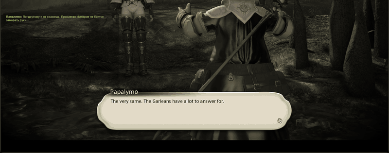

<p align="center">
  
</p>

<h1 align="center">Tataru Helper</h1>

<p align="center">《最终幻想14》实时翻译悬浮窗：主线剧情、过场动画、任务、NPC 对白和聊天。</p>
<p align="center">由 [xDarkOne](https://github.com/xDarkOne) 维护，原作者为 [NightlyRevenger](https://github.com/NightlyRevenger)。</p>

<p align="center">
  <a href="https://github.com/NightlyRevenger/TataruHelper/actions/workflows/build.yml"></a>
  <a href="https://github.com/NightlyRevenger/TataruHelper/releases/latest"></a>
  
  
  <a href="../LICENSE"></a>
  <a href="https://github.com/NightlyRevenger/TataruHelper/releases"></a>
  <a href="https://crowdin.com/project/tataru-helper"></a>
  <a href="https://discord.gg/bSrpbd9"></a>
</p>

<p align="center"><strong><a href="https://github.com/NightlyRevenger/TataruHelper/releases/latest/download/Setup.exe">下载 Setup.exe</a></strong> · <a href="Guide.MD">指南（英文）</a> · <a href="Linux.md">Linux</a> · <a href="https://github.com/NightlyRevenger/TataruHelper/wiki">FAQ</a> · <a href="https://discord.gg/bSrpbd9">Discord</a></p>

<p align="center"><strong>语言:</strong> <a href="../README.md">EN</a> | <a href="README_ru_RU.md">RU</a> | <a href="README_ko_KR.md">KO</a> | <a href="README_es_ES.md">ES</a> | <a href="README_ca_ES.md">CA</a> | <a href="README_pl_PL.md">PL</a> | <a href="README_pt_BR.md">PT-BR</a> | <a href="README_uk_UA.md">UK</a> | <a href="README_zh_ZH.md">ZH</a> | <a href="README_ja_JP.md">JA</a></p>

<p align="center">
  
</p>

## 功能

- 随游戏文本出现即时翻译：主线剧情、过场字幕、任务、NPC 对白和聊天。
- 直接从游戏中读取文本，无需复制粘贴。
- 支持多种翻译引擎（包括免费引擎），某个引擎失败时自动切换到其他引擎。参见[翻译引擎](#翻译引擎)。
- 可同时使用多个独立的聊天窗口，每个窗口有各自的引擎、语言、字体、颜色和快捷键。
- 可选择翻译哪些聊天频道，并为每个频道设置颜色。
- 有人工翻译时，显示 [XIV Rus Translation](https://github.com/xivrus/xiv_ru_weblate) 而不是机器翻译。
- 悬浮窗支持点击穿透、始终置顶、自动隐藏，并可用快捷键控制。
- 界面支持 12 种语言，更新会自动安装。

## 系统要求

- 使用 DirectX 11 运行的《最终幻想14》（64 位客户端）。
- **64 位 Windows 10 或 11。** 启动时会请求管理员权限：程序需要从游戏内存中读取文本。无需安装 .NET，发行版已自带。
- **或 Linux**，游戏通过 Wine 运行。参见 [Linux 上的 TataruHelper](Linux.md)；该支持尚属实验性质（英文文档）。

## 安装

### Windows

1. 从[latest release](https://github.com/NightlyRevenger/TataruHelper/releases/latest)下载 [`Setup.exe`](https://github.com/NightlyRevenger/TataruHelper/releases/latest/download/Setup.exe)。
2. 运行它。如果出现 SmartScreen，请点击**更多信息**，然后点击**仍要运行**。
3. 先启动游戏，再从开始菜单或桌面快捷方式启动 Tataru Helper（不要再次运行 `Setup.exe`）。更新会自动安装。
4. 在设置中选择游戏语言和你要阅读的语言，并把悬浮窗放在合适的位置。
5. 在游戏的聊天设置中，于任意标签页开启下图所示的消息类型：


每个版本还附带便携版 `Portable.zip`。

### Linux

```sh
curl -LO https://raw.githubusercontent.com/NightlyRevenger/TataruHelper/master/scripts/linux/tataru-linux.sh
chmod +x tataru-linux.sh
./tataru-linux.sh install
```

脚本会找到运行游戏的 Wine，并在其旁边启动 Tataru Helper。详细说明、已支持和尚未支持的功能以及故障排除见 [Documents/Linux.md](Linux.md)（英文）。

## 翻译引擎

| 类型 | 引擎 |
| --- | --- |
| 免费，无需密钥或账号 | DeepL（通过自带的本地中继）、Google Translate、Yandex、Bing、Translate.com、ModernMT、Papago；可另行开启 Tencent TranSmart、Volcengine 和 Alibaba |
| 使用你自己的密钥 | DeepL API, Google Cloud, Azure Translator, Yandex Cloud, OpenAI, Claude, Gemini, DeepSeek, YandexGPT, OpenRouter |
| 在你的电脑或服务器上 | Ollama, LM Studio, LibreTranslate |

某个引擎拒绝请求时，由下一个已启用的引擎接手。各引擎的设置方法见[指南](Guide.MD#translation)（英文）。

## 文档

- [指南](Guide.MD)（[俄文版](GuideRU.MD)）：每个设置页面的说明，英文。
- [Linux 上的 TataruHelper](Linux.md)（[俄文版](LinuxRU.md)），英文。
- [FAQ](https://github.com/NightlyRevenger/TataruHelper/wiki)与故障排除，提供多种语言。
- [游戏读取原理](ReadingTheGame.md)：如何从游戏中读取对白，供要修改这部分的人参考（英文）。
- 视频：[YouTube 演示](https://youtu.be/7HiQXzmkQuw)。




## 参与贡献

- 提问与建议：[Discord](https://discord.gg/bSrpbd9)或[issues](https://github.com/NightlyRevenger/TataruHelper/issues/new/choose)。
- 代码：欢迎提交 pull request，请先阅读 [CONTRIBUTING.md](../CONTRIBUTING.md)（英文）。
- 界面翻译：[Crowdin](https://crowdin.com/project/tataru-helper)。
- 安全问题：[SECURITY.md](../SECURITY.md)。

## 致谢

感谢所有贡献者，以及让 Tataru Helper 得以实现的项目：

- [TataruHelper (NightlyRevenger)](https://github.com/NightlyRevenger/TataruHelper): 原版项目，本项目是它的分支
- [TataruHelper (progneo)](https://github.com/progneo/TataruHelper): 本项目所延续的分支
- [Sharlayan](https://github.com/FFXIVAPP/sharlayan): 从游戏内存中读取文本
- [XIV Rus Translation](https://github.com/xivrus/xiv_ru_weblate): 人工俄语翻译
- [WPF Toolkit](https://github.com/xceedsoftware/wpftoolkit)
- [NHotKey.Wpf](https://github.com/thomaslevesque/NHotkey)
- [NotifyIcon WPF](https://bitbucket.org/hardcodet/notifyicon-wpf/)
- [Velopack](https://github.com/velopack/velopack): 安装与更新程序
- [Tataru Art (Nezusagi)](https://www.deviantart.com/nezusagi)

### 换一种方式

如果你使用 [Dalamud](https://github.com/goatcorp/Dalamud)，也不妨了解 [Echoglossian](https://github.com/lokinmodar/Echoglossian)：这是一个在游戏内部翻译对白的插件，而不是在旁边的悬浮窗里。

## 许可证

[MIT](../LICENSE)
