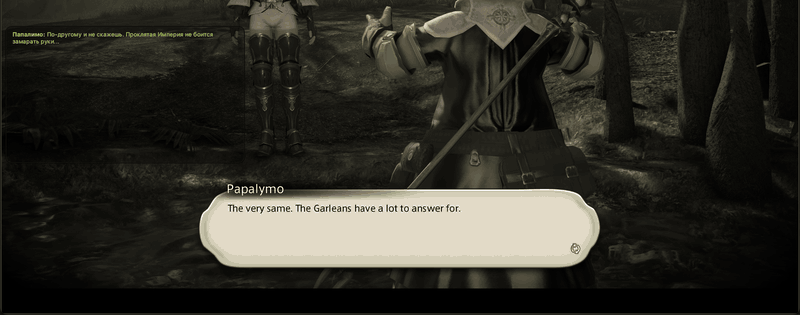

<p align="center">
  
</p>

<h1 align="center">Tataru Helper</h1>

<p align="center">Real-time translation overlay for Final Fantasy XIV: story, cutscenes, quests, NPC lines and chat.</p>
<p align="center">Maintained by <a href="https://github.com/xDarkOne">xDarkOne</a>. Originally created by <a href="https://github.com/NightlyRevenger">NightlyRevenger</a>.</p>

<p align="center">
  <a href="https://github.com/NightlyRevenger/TataruHelper/actions/workflows/build.yml"></a>
  <a href="https://github.com/NightlyRevenger/TataruHelper/releases/latest"></a>
  
  
  <a href="LICENSE"></a>
  <a href="https://github.com/NightlyRevenger/TataruHelper/releases"></a>
  <a href="https://crowdin.com/project/tataru-helper"></a>
  <a href="https://discord.gg/bSrpbd9"></a>
</p>

<p align="center"><strong><a href="https://github.com/NightlyRevenger/TataruHelper/releases/latest/download/Setup.exe">Download Setup.exe</a></strong> · <a href="Documents/Guide.MD">Guide</a> · <a href="Documents/Linux.md">Linux</a> · <a href="https://github.com/NightlyRevenger/TataruHelper/wiki">FAQ</a> · <a href="https://discord.gg/bSrpbd9">Discord</a></p>

<p align="center"><strong>Languages:</strong> <a href="README.md">EN</a> | <a href="Documents/README_ru_RU.md">RU</a> | <a href="Documents/README_ko_KR.md">KO</a> | <a href="Documents/README_es_ES.md">ES</a> | <a href="Documents/README_ca_ES.md">CA</a> | <a href="Documents/README_pl_PL.md">PL</a> | <a href="Documents/README_pt_BR.md">PT-BR</a> | <a href="Documents/README_uk_UA.md">UK</a> | <a href="Documents/README_zh_ZH.md">ZH</a> | <a href="Documents/README_ja_JP.md">JA</a></p>

<p align="center">
  
</p>

## Features

- Translates the game's text as it appears: the main story, cutscene subtitles, quests, NPC lines and chat.
- Reads the text from the game itself, so there is no copying and pasting.
- Many translation engines, free ones included, with automatic fallback to another engine when one fails. See [Translation engines](#translation-engines).
- Several independent chat windows, each with its own engine, languages, fonts, colors and hotkeys.
- Choose which chat channels are translated, and the color of each.
- Shows the hand-made [XIV Rus Translation](https://github.com/xivrus/xiv_ru_weblate) instead of a machine's where one exists.
- The overlay can be click-through, always on top, auto-hiding, and toggled by hotkeys.
- Interface in 12 languages. Updates install themselves.

## Requirements

- Final Fantasy XIV with DirectX 11 (the 64-bit client).
- **Windows 10 or 11, 64-bit.** Administrator rights are requested on start: the application reads the game's text out of the game's memory. No .NET runtime to install: the release carries its own.
- **Or Linux** with the game running under Wine. See [TataruHelper on Linux](Documents/Linux.md); this support is experimental.

## Install

### Windows

1. Download [`Setup.exe`](https://github.com/NightlyRevenger/TataruHelper/releases/latest/download/Setup.exe) from the [latest release](https://github.com/NightlyRevenger/TataruHelper/releases/latest).
2. Run it. If SmartScreen appears, select **More info**, then **Run anyway**.
3. Start the game, then Tataru Helper from the Start menu or the desktop shortcut (not `Setup.exe` again). Updates install themselves.
4. In the settings, pick the game language and the language you want to read, then place the overlay where you like.
5. In the game's chat settings, turn on the message types shown below, on any tab:


A portable build, `Portable.zip`, is attached to every release.

### Linux

```sh
curl -LO https://raw.githubusercontent.com/NightlyRevenger/TataruHelper/master/scripts/linux/tataru-linux.sh
chmod +x tataru-linux.sh
./tataru-linux.sh install
```

The script finds the Wine your game runs on and starts Tataru Helper beside it. Details, what works, what does not yet, and troubleshooting are in [Documents/Linux.md](Documents/Linux.md).

## Translation engines

| Kind | Engines |
| --- | --- |
| Free, no key or account | DeepL (through a bundled local relay), Google Translate, Yandex, Bing, Translate.com, ModernMT, Papago; Tencent TranSmart, Volcengine and Alibaba can be turned on |
| With your own key | DeepL API, Google Cloud, Azure Translator, Yandex Cloud, OpenAI, Claude, Gemini, DeepSeek, YandexGPT, OpenRouter |
| On your machine or server | Ollama, LM Studio, LibreTranslate |

When an engine refuses a request, the next enabled one takes over. How to set each one up is in the [Guide](Documents/Guide.MD#translation).

## Documentation

- [Guide](Documents/Guide.MD) ([по-русски](Documents/GuideRU.MD)): every settings page explained.
- [TataruHelper on Linux](Documents/Linux.md) ([по-русски](Documents/LinuxRU.md)).
- [FAQ and troubleshooting](https://github.com/NightlyRevenger/TataruHelper/wiki), in several languages.
- [Reading the game](Documents/ReadingTheGame.md): how dialogue is read out of the game, for anyone changing that part.
- Video: [YouTube demonstration](https://youtu.be/7HiQXzmkQuw).




## Contributing

- Questions and ideas: [Discord](https://discord.gg/bSrpbd9) or [issues](https://github.com/NightlyRevenger/TataruHelper/issues/new/choose).
- Code: pull requests are welcome; read [CONTRIBUTING.md](CONTRIBUTING.md) first.
- Translating the interface: [Crowdin](https://crowdin.com/project/tataru-helper).
- Security problems: [SECURITY.md](SECURITY.md).

## Credits

Thanks to all contributors and the projects that helped make Tataru Helper possible:

- [TataruHelper by NightlyRevenger](https://github.com/NightlyRevenger/TataruHelper): the original, which this is a fork of
- [TataruHelper by progneo](https://github.com/progneo/TataruHelper): the fork this one carries on from
- [Sharlayan](https://github.com/FFXIVAPP/sharlayan): reads the game's text out of its memory
- [XIV Rus Translation](https://github.com/xivrus/xiv_ru_weblate): the hand-made Russian translation
- [WPF Toolkit](https://github.com/xceedsoftware/wpftoolkit)
- [NHotKey.Wpf](https://github.com/thomaslevesque/NHotkey)
- [NotifyIcon WPF](https://bitbucket.org/hardcodet/notifyicon-wpf/)
- [Velopack](https://github.com/velopack/velopack): the installer and updater
- [Tataru Art by Nezusagi](https://www.deviantart.com/nezusagi)

### Doing the same thing another way

If you play with [Dalamud](https://github.com/goatcorp/Dalamud), it is worth knowing about
[Echoglossian](https://github.com/lokinmodar/Echoglossian): a plugin that translates dialogue
inside the game rather than in an overlay beside it.

## License

[MIT](LICENSE)
